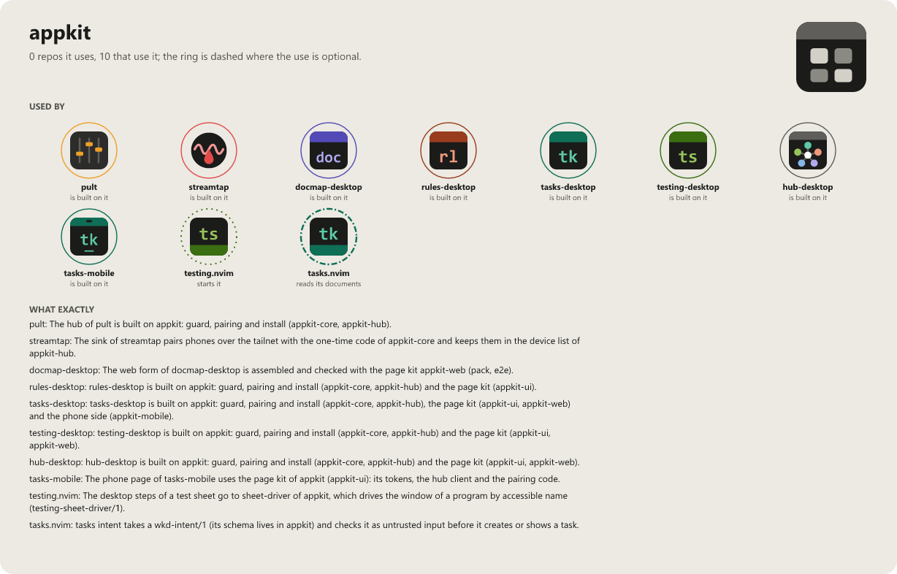

# appkit

The shared foundation of the local desktop hubs of
[tasks-desktop](https://github.com/WKDSteve/tasks-desktop) and `rules-desktop`: a web server on
your own machine that serves an app's page and data to the browser, asks a Neovim engine for the
data, and never trusts anything that reaches it.

It was taken out of `tasks-desktop`, where it was written, so that every app gets the same guard
and the same tests. It knows no app: an app brings its names, its routes and its engine.

## Crates

| Crate | What it is |
|---|---|
| `appkit-core` | Building blocks without a server: the names of an app (`AppIdentity`), the data classes and who asks (`DataClass`, `Caller`), pairing and sessions, safe process runs and reads, `hub.json`, `control.secret`. |
| `appkit-hub` | The hub without the app: the guard (eight steps, in a fixed order), pairing, the page, `hello`, the list of vaults, the accept loop, the seam of the engine (one process per call, or a persistent host), the snapshot store, the file watcher, the full-text search, the event streams (count per session, the `text/event-stream` body), opening a file in Neovim, showing a folder and the folder dialog (`editor`), the phones of an app on the PC (`phone`: the pairing link and its QR code, the list, levels and revoking), Web Push to paired devices (`push`, VAPID without a push account; the sending behind the feature `push-net`), the settings file, the search for Neovim and the engine, installing, autostart and the first-start questions, and for hubs that start other programs: `launch` (argv only, stdio null, nothing inherited) and `browser` (opens only `http://127.0.0.1:<port>/…` for the ports an app names). |
| `appkit-mobile` | The phone side of a hub, for the shell of a phone app (Tauri): the three ways to the data (Tailscale Serve, an SSH tunnel, a vault cloned on the phone), the pairing link, pairing and the device login with a key the phone keeps, the check that the hub is the one paired with, every request with a time and a byte limit and only to the app's routes, the kept pairing and the kept copy of the answers. See [docs/MOBILE.md](docs/MOBILE.md). |
| `tauri-plugin-appkit` (`mobile-plugin/`) | The Android side of a phone app (Tauri 2, Kotlin): device keys in the Keystore with the trigger key behind the biometrics, the QR code of a pairing, the folder of a cloned vault, UnifiedPush. Its own Cargo project; an app depends on it by the tag. See [docs/MOBILE.md](docs/MOBILE.md). |
| `appkit-testkit` | The security matrix every app's hub must pass, a second minimal app (`Demo`) that proves the guard knows no app, and a fake engine to test without Neovim. |
| `sheet-driver` | A program, not a library: drives the window of an app for a test sheet of testing.nvim the way a screen reader does (`testing-sheet-driver/1` on stdin and stdout, UI Automation on Windows). Only the process it is pointed at; a name that is not there or there twice never acts. A `wait` or `expect` with `window` reads in the one window of another program whose title has that part (Explorer, a browser; never the app's own), without sizing or acting in it; while such windows come and go, a `wait` keeps waiting. |
| `appkit-scratch` | Test support of the kit's own crates only: `Scratch`, a folder in the temp dir that is removed when the test ends, also when it fails. CI fails when the tests leave anything in the temp dir. |
| `ui-kit` (`appkit-ui`) | The browser side, Svelte 5 and TypeScript source: the design tokens and base rules, the menu bar, the multi-select, the info button, the markdown reader, the hint popup, the event-stream reader, the pairing code, the hidden-character guard, and for a phone app the bridge to its shell (`ipcFetch`) and the queue of its writes. See [ui-kit/README.md](ui-kit/README.md). |
| `web-kit` (`appkit-web`) | The parts of an app's web variant (one HTML file opened from disk, no server) that know no app: packing the page into one file with the parts and the policy the app names, and the check that its shell loads nothing; the folder the page works in (picker, folder input, the folders used before in an IndexedDB of the app's own name), the look at the folder, the cache kept per folder, and the browser-test watch on requests and policy violations. Plain JavaScript with types. See [web-kit/README.md](web-kit/README.md). |
| `release-kit` | How an app is published: GitHub Actions for the rolling build `latest` and the release drafts, and the install scripts (`install.ps1`, `install.sh`) every release carries, stamped with its channel. Any native app can use it, also one without the crates. See [release-kit/README.md](release-kit/README.md). |

## What goes where

An app and its web variant are one app with two builds, not two apps:

| What | Where |
|---|---|
| The page of an app, the same for the hub and the web variant | its `*-desktop` repo, one source with two entry points (for tasks: `ui/src/main.ts` for the hub, `ui/src/main.web.ts` for the web variant) |
| The built web variant | its `*-web` repo, release files only, no source. The page is one self-contained file that works on its own: download it, open it in the browser, pick the folder. |
| Something a **second** app needs | here, in `ui-kit` or a crate |

There is no shared repo per app family (such as `tasks-shared`): it would have one user, the app
that already holds the code, and add a third chain of tags between the app and the kit. Code moves
here when a second app needs it, not ahead of time.

## Using it

There are no releases on crates.io. An app depends on a tag:

```toml
[dependencies]
appkit-hub = { git = "https://github.com/WKDSteve/appkit", tag = "v0.1.0" }

[dev-dependencies]
appkit-testkit = { git = "https://github.com/WKDSteve/appkit", tag = "v0.1.0" }
```

The page of an app takes the same tag, by its folder (`pnpm-lock.yaml` pins the commit):

```
pnpm add "git+https://github.com/WKDSteve/appkit.git#vX.Y.Z&path:ui-kit"
```

A web variant takes `appkit-web` the same way, by the same tag:

```
pnpm add "git+https://github.com/WKDSteve/appkit.git#vX.Y.Z&path:web-kit"
```

`Cargo.lock` then pins the commit of the tag. To work on the kit and an app at once, point the app at
a local checkout in a `.cargo/config.toml` that is not committed:

```toml
[patch."https://github.com/WKDSteve/appkit"]
appkit-core = { path = "../appkit/crates/appkit-core" }
appkit-hub = { path = "../appkit/crates/appkit-hub" }
appkit-testkit = { path = "../appkit/crates/appkit-testkit" }
```

An app runs the security matrix for its own hub:

```rust
mod my_app {
    appkit_testkit::security_matrix!(my_app_testkit::MyApp);
}
```

## A hub without a vault

An app that holds no data and runs no engine (the central hub that only lists and starts other
apps) needs no vault and no Neovim. It builds its hub from `appkit-hub::serve` with

- a `Runtime` that keeps only a `HubStatus` (`engine_ready: false`, no capabilities); `stop` does nothing,
- `vaults: None` in `ServeParts` and a `build` that is never called,
- the routes it brings itself, and `Pages` for its page,

and it does not call `setup::run`: the first-start questions are about a vault. `Demo` in
`appkit-testkit` is exactly this app, and `tests/no_vault.rs` runs it. No change of `Core` was
needed, a Dummy-runtime is the supported way.

An app that does need setup says so in `hello`: `Runtime::setup_required()` returns a short code
(`no_vault`), and `hello` carries `setup_required` (bool) and `setup_reason` (code or `null`). A
program that lists apps shows "setup needed" instead of a page that cannot work.

`hello` also carries `build`: the short commit id of a rolling build (`ServeParts::build_id`), or `null` for a release or
a build that does not know it. Only 1 to 40 ASCII letters and digits are reported, so a program that lists apps
(the hub) can compare it with the title of the rolling release (`Rolling build (<sha7>)`).

## Where the hub looks for the engine

The checkout of an app's Neovim engine (`rules.nvim`, `tasks.nvim`) is looked for in this order, and the
first value that is set decides:

1. `engine_dir` in the settings file of the app,
2. the environment variable the app names (`RULES_ENGINE_DIR`),
3. `$REPOS_DIR/<name>`, the folder of that checkout below the folder that holds all your checkouts.

A value that is set but wrong is an error that names it; there is no quiet fall back to the next place.
`REPOS_DIR` is optional: without it and without the other two, the setup page says that nothing was
found and lists the three places that were tried. The shared library (`lib.nvim`) is found the same way,
and also as a sibling of the engine checkout.

```text
RULES_ENGINE_DIR=D:\code\rules.nvim    # explicit
REPOS_DIR=D:\code                       # finds D:\code\rules.nvim and D:\code\lib.nvim
```

## Starting programs and opening pages

`launch::spawn(program, args, &LaunchOpts { cwd, window })` starts a program of somebody else:
the program is an absolute path to a file, the arguments an argv (never a shell string), stdin,
stdout and stderr are the null device, the standard handles of this process are made not
inheritable first (otherwise the child holds a pipe or log of its parent open), and the working
folder and the kind of window are always named. It never hides a window (`CREATE_NO_WINDOW`,
`DETACHED_PROCESS`). `browser::open(url, ports)` opens a link in the default browser only when
it is `http://127.0.0.1:<port>/…` with a port from the list and plain characters after it.

## Ports

The default ports of the apps that run side by side are listed in
[`appkit-testkit/src/ports.rs`](crates/appkit-testkit/src/ports.rs); `tests/ports.rs` fails when
two share one. Free: 17612–17614, 17619–17649.

## Checks

```
cargo fmt --all --check
cargo clippy --workspace --all-targets --all-features --locked -- -D warnings
cargo test --workspace --all-features --locked
cargo deny check
cargo audit
python3 tools/check-lock-age.py --min-days 7
python3 -m unittest discover -s release-kit -p "test_*.py"
pnpm -C ui-kit install --frozen-lockfile && pnpm -C ui-kit check && pnpm -C ui-kit test
pnpm -C web-kit test
```

The CI runs all of them on Windows and `cargo clippy` and `cargo test` also on macOS and Linux. See [SECURITY.md](SECURITY.md) for what the hub protects
against and [docs/RELEASING.md](docs/RELEASING.md) for how a version is made.

Comments and docs name the maintainer's design notes ("concept 5.5", "concept 13.14"); those notes
are not public, the code and its tests are the reference.

## License

MIT, see [LICENSE](LICENSE).

<!-- connections:begin (written by the app-icons tool of the workshop; change integrations.json there, not this block) -->
## Connections



**Used by**

- [docmap-desktop](https://github.com/WKDSteve/docmap-desktop): The web form of docmap-desktop is assembled and checked with the page kit `appkit-web` (`pack`, `e2e`). ([picture](assets/graphs/pair/docmap-desktop--appkit.png))
- [hub-desktop](https://github.com/WKDSteve/hub-desktop): hub-desktop is built on appkit: guard, pairing and install (`appkit-core`, `appkit-hub`) and the page kit (`appkit-ui`, `appkit-web`). ([picture](assets/graphs/pair/hub-desktop--appkit.png))
- [pult](https://github.com/WKDSteve/pult): The hub of pult is built on appkit: guard, pairing and install (`appkit-core`, `appkit-hub`). ([picture](assets/graphs/pair/pult--appkit.png))
- [rules-desktop](https://github.com/WKDSteve/rules-desktop): rules-desktop is built on appkit: guard, pairing and install (`appkit-core`, `appkit-hub`) and the page kit (`appkit-ui`). ([picture](assets/graphs/pair/rules-desktop--appkit.png))
- [streamtap](https://github.com/WKDSteve/streamtap): The sink of streamtap pairs phones over the tailnet with the one-time code of `appkit-core` and keeps them in the device list of `appkit-hub`. ([picture](assets/graphs/pair/streamtap--appkit.png))
- [tasks-desktop](https://github.com/WKDSteve/tasks-desktop): tasks-desktop is built on appkit: guard, pairing and install (`appkit-core`, `appkit-hub`), the page kit (`appkit-ui`, `appkit-web`) and the phone side (`appkit-mobile`). ([picture](assets/graphs/pair/tasks-desktop--appkit.png))
- [tasks-mobile](https://github.com/WKDSteve/tasks-mobile): The phone page of tasks-mobile uses the page kit of appkit (`appkit-ui`): its tokens, the hub client and the pairing code. ([picture](assets/graphs/pair/tasks-mobile--appkit.png))
- [tasks.nvim](https://github.com/WKDSteve/tasks.nvim): `tasks intent` takes a `wkd-intent/1` (its schema lives in appkit) and checks it as untrusted input before it creates or shows a task. ([picture](assets/graphs/pair/tasks.nvim--appkit.png))
- [testing-desktop](https://github.com/WKDSteve/testing-desktop): testing-desktop is built on appkit: guard, pairing and install (`appkit-core`, `appkit-hub`) and the page kit (`appkit-ui`, `appkit-web`). ([picture](assets/graphs/pair/testing-desktop--appkit.png))
- [testing.nvim](https://github.com/WKDSteve/testing.nvim): The desktop steps of a test sheet go to `sheet-driver` of appkit, which drives the window of a program by accessible name (`testing-sheet-driver/1`). ([picture](assets/graphs/pair/testing.nvim--appkit.png))
<!-- connections:end -->
